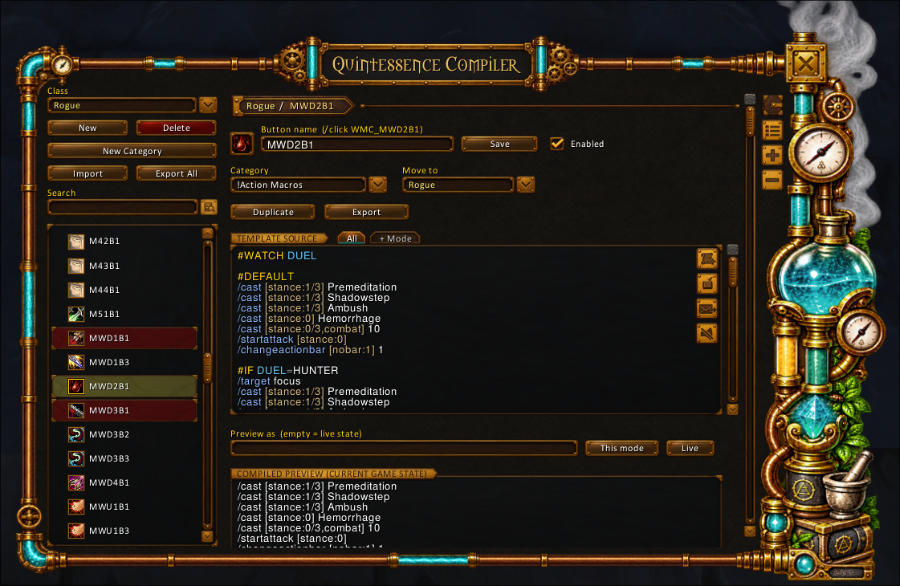
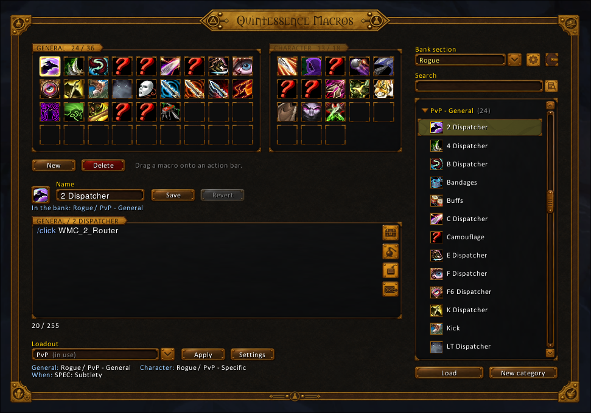
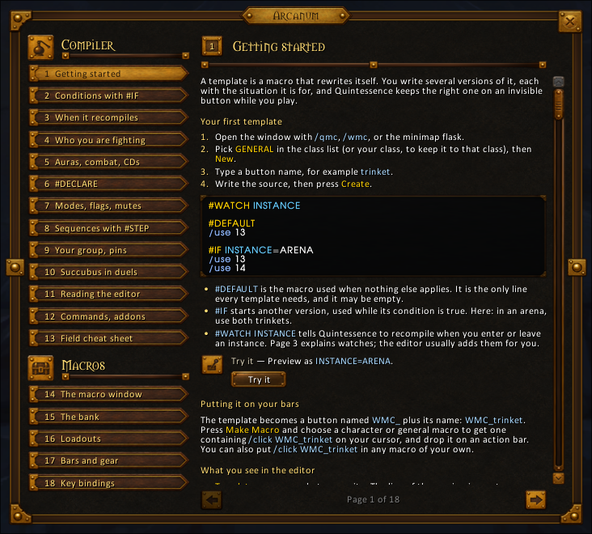

<p align="center">
  
</p>

<h1 align="center">Quintessence</h1>

**The macro addon for World of Warcraft 3.3.5a (Wrath of the Lich King).** Create macros that rewrite themselves depending on game state, and get past the game's limitations on macro slots and macro length.

- **The Compiler**: a template is a macro with several versions, each for its own situation: an arena, a duel, a raid, or something more specific, such as the duel opponent's class or a particular aura. Quintessence keeps the right version on an invisible button while you play, and your action bar runs it with `/click`.
- **Quintessence Macros**: a replacement for Blizzard's macro window, with a bank that can store as many macros as you like, account-wide, and loadouts that set up your macro slots, action bars and gear set for each spec.

```text
#WATCH INSTANCE

#DEFAULT
/use 13

#IF INSTANCE=ARENA
/use 13
/use 14
```

<p align="center"><br>
<em>The Compiler: a template, its versions and the compiled macro</em></p>

<p align="center"><br>
<em>Quintessence Macros: the bank, your macro slots and loadouts</em></p>

<p align="center"><br>
<em>Arcanum: the built-in guide</em></p>

## Features

- **Conditions** on your target, focus, party, arena opponents and duel opponent: class, spec, name, reaction, auras (with time left and stacks), combat state, your own cooldowns, your pet, the instance and zone.
- **Modes**: one tab per situation (arenas, raids, duels, or one you switch on yourself with a flag), and lines you can mute in a mode.
- **Sequences** with `#STEP`: the next step on every press, in combat too. Unlike `/castsequence`, a failed cast never holds it up: a spell on cooldown or out of range is skipped and the next press moves on. One press is one step, so pace your presses to the global cooldown. Several `/cast` lines in a single step act as a priority list: the first spell that's ready is cast.
- **Your group by class or role**: `[@PRIEST]`, `[@MAINTANK]`, `/target ROGUE`. They become the player's name, so raid group moves don't break them. You can pin who a placeholder means.
- **Arena and duels**: the enemy team and your duel opponent go straight into your macro text. In a duel against a warlock, `SUCCUBUS` becomes their succubus's name.
- **An editor** with syntax colouring, error marks, **Preview as** (try any game state in the editor) and a built-in guide with examples you can try.
- **Quintessence Macros** (`/qmb`): a replacement for Blizzard's macro window, with a bank that keeps far more macros than the game's slots, account-wide, and **loadouts** that fill your macro slots, action bars and gear set for each spec.
- **Key bindings** without macro slots: bind a key straight to a template or a bank macro (right-click its row). The key list shows every binding, and you can import your BindPad bindings. See the guide's Key bindings page.
- **An API for other addons**: a WeakAura or a raid addon can switch flags and pin players (the guide's *Commands and other addons* page).

Buttons can't change in combat, a limitation imposed by the game: a template picks its version before the fight, and anything that changes during it is applied when combat ends.

## Install

1. Download `Quintessence-<version>.zip` from the [Releases](../../releases) page. (Not the green *Code* button or "Source code": those unzip to a folder with the wrong name.)
2. Unzip it into `World of Warcraft/Interface/AddOns`, so you have `Interface/AddOns/Quintessence/Quintessence.toc`.
3. Start the game and type `/qmc`.

## Getting started

- `/qmc` opens the editor. `/qmc guide`, or the book at the editor's right edge, opens the guide: start with *Getting started*.
- `/qmb` opens the macro window and the bank.
- `/qmc help` lists every command.

## License

MIT: see [LICENSE](LICENSE). The bundled Ace3 libraries (LibStub, CallbackHandler-1.0, AceGUI-3.0) keep their own license, in `Quintessence/Libs/LICENSE.txt`.
